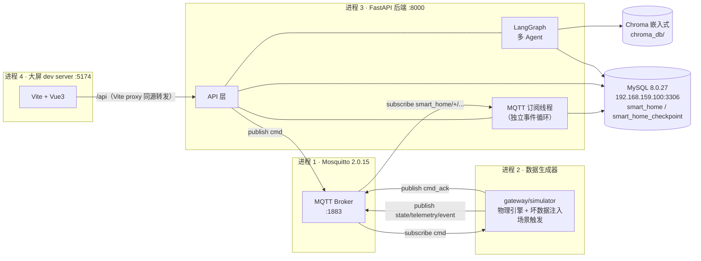
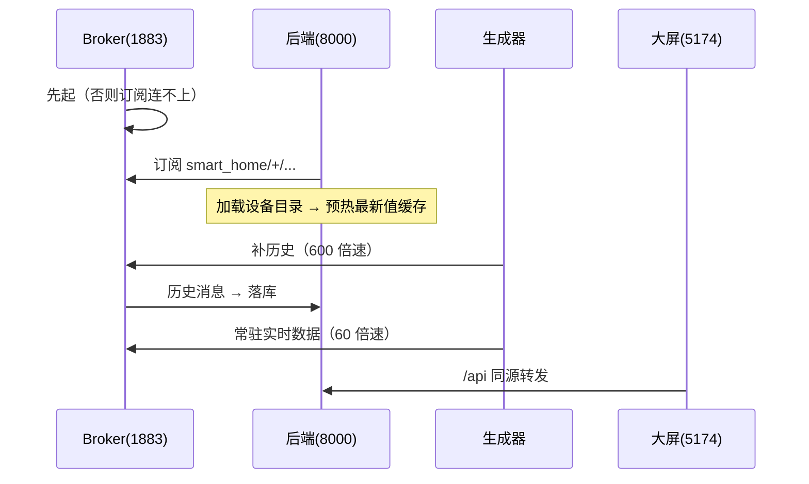
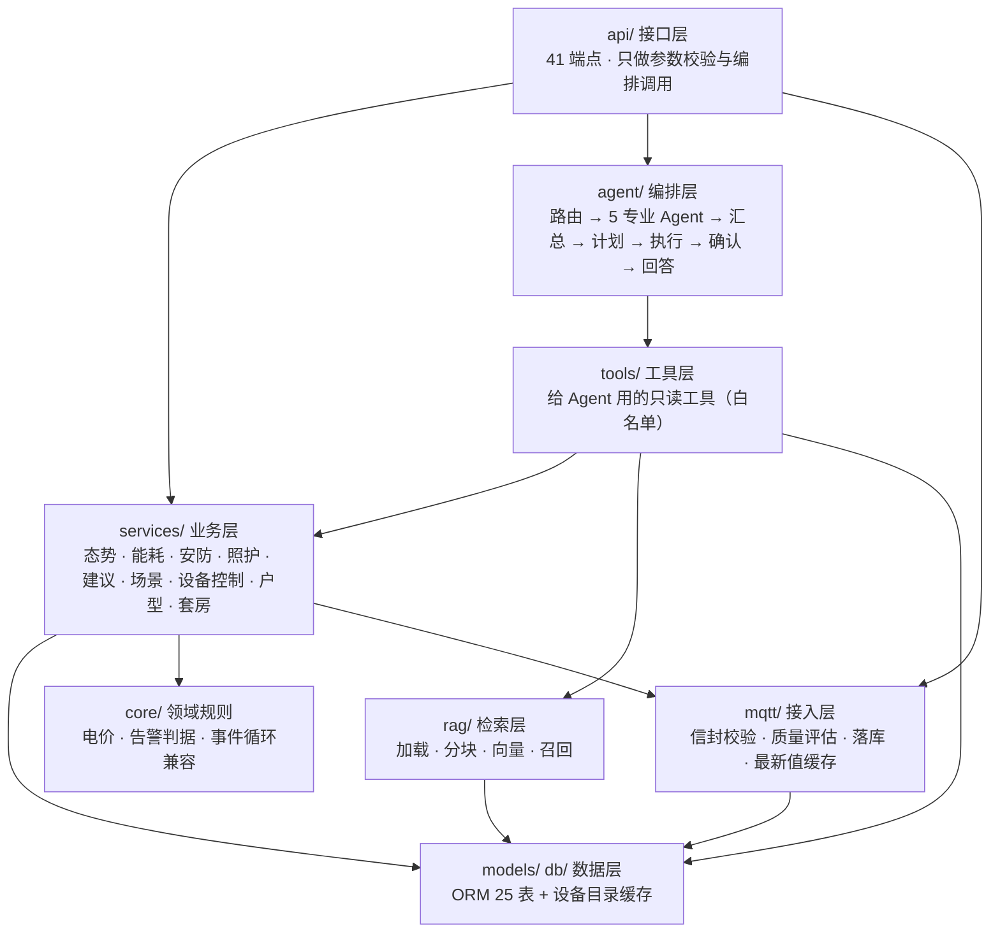
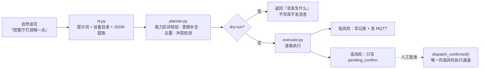
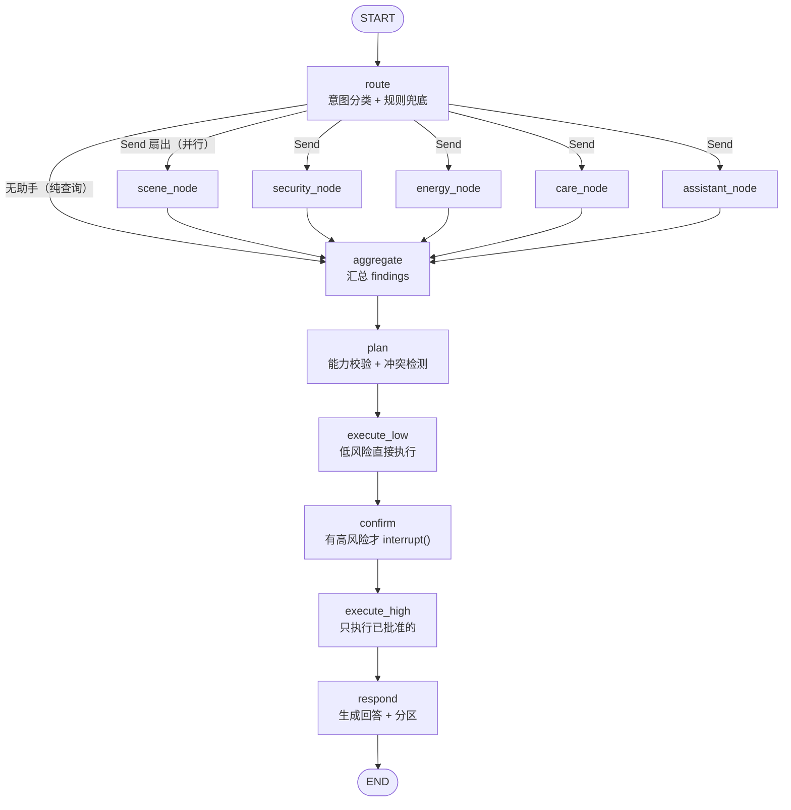
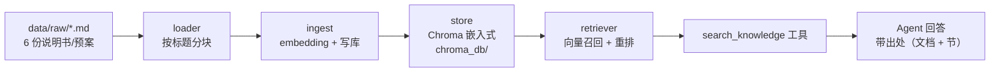

# 智能家居 AI 助手 · 项目架构说明书

| 项目 | 内容 |
|---|---|
| 文档版本 | v1.0 |
| 日期 | 2026-10-20 |
| 对应代码 | 41,542 行 / 172 文件（**不含手机端** `frontend/mobile`），数据库 25 表 / 218 字段，API 41 个端点 |
| 读者 | 答辩老师、接手二次开发者、写论文"系统设计"章节的自己 |
| 与其它文档的关系 | 需求基线见《智能家居AI助手项目需求分析》；里程碑与验收标准见《智能家居AI助手项目规划书》；选型对比与实测记录见《技术选型方案》。**本文只讲"现在这套代码是怎么搭起来的、为什么这么搭"**，不重复需求论证 |

> **一句话定位**：一套跑在单机上的智能家居 AI 助手后端 + PC 大屏。设备数据由 MQTT 数据生成器模拟，AI 侧是"1 个协调器 + 5 个专业 Agent"的 LangGraph 编排，外加长期记忆与说明书 RAG；所有涉及门锁 / 燃气阀 / 电气总闸 / 布防撤防的动作，**只能人工批准后执行一次，绝不自动执行**。

---

## 0. 阅读指南

按需要跳读，不必从头看到尾：

| 你想知道 | 看哪节 |
|---|---|
| 这套系统由几个进程组成、怎么跑起来 | §2、§9 |
| 代码为什么按 api / services / agent / mqtt 分层 | §4 |
| MQTT 消息长什么样、坏数据怎么被拦住 | §5.1 |
| 数据库为什么这么设计、没有 DDL 权限怎么办 | §5.2 |
| 自然语言怎么变成设备动作（场景编排） | §5.4 |
| 多 Agent 是怎么协作的、冲突怎么办 | §5.5 |
| "AI 说要开门"为什么不会真开 | §5.7、§8.1 |
| 告警 / 照护 / 建议为什么会自己冒出来 | §5.8 |
| 前端 8 个页面怎么组织、数据怎么流 | §7 |
| 怎么证明这套东西是可信的 | §10 |
| 已知短板与后续 | §11 |

---

## 1. 系统概览

### 1.1 能力地图

| 能力域 | 用户看到的样子 | 落到代码 |
|---|---|---|
| 态势感知 | 房屋总览（户型图 + 房间读数）、设备列表与能力档案 | `services/overview.py`、`api/devices.py`、`frontend/src/pages/overview` |
| 能耗分析 | 分时电价、逐小时曲线、高耗设备排行 | `core/tariff.py`、`services/analytics.py`、`api/energy.py` |
| 场景编排 | 一句话生成动作序列 → 冲突检测 → 执行 | `services/scenes/*`、`api/scenes.py` |
| 多 Agent 对话 | 流式回答 + 执行过程 + 待确认弹窗 | `agent/*`、`api/chat.py`、`pages/chat` |
| 安防 / 照护 / 建议 | 告警列表、活动节律时间轴、主动建议 | `services/safety.py`、`services/care.py`、`services/suggestions.py` |
| 知识库 | 说明书检索（带出处） | `rag/*`、`api/knowledge.py` |
| 设备直控 | 滑块调光、开关、门锁（高风险走确认） | `services/device_control.py`、`api/device_commands.py` |
| 多套房 | 套房切换、每套独立户型与设备 | `services/homes_admin.py`、`db/catalog.py` |

### 1.2 三条硬约束（整个架构都是绕着它们长的）

**① 没有真实设备采集。**
数据只能来自生成器（MQTT 上报）或手工注入。因此每条记录都带 `source` 与 `quality`，前端显式标注"模拟"，**不允许把模拟数据伪装成实测值**。数据源本身可插拔（`DATA_MODE` = `mock` / `mqtt` / `csv` / `real_gateway`），上层业务代码完全不感知。

**② 应用账号没有 DDL 权限。**
数据库在虚拟机（MySQL 8.0.27），后端用 `app_rw` 连接，只有 SELECT/INSERT/UPDATE/DELETE。这条约束直接决定了几个设计：
- 表结构只能靠 `mysql/init/*.sql` 由 root 手动执行，ORM 与库的对齐要**靠脚本校验**（`schema_check.py`）；
- 临时新增的字段语义一律塞进已有的 JSON 列（场景收藏 `scenes.definition_json["favorite"]`、指令参数 `device_commands.params_json`），**不去 ALTER TABLE**；
- 户型几何这种"新领域对象"干脆不落库，存 `config/floorplans/{home_id}.json`。

**③ 高风险设备绝不自动执行。**
门锁、燃气阀、电气总闸、布防撤防四类：自动路径（场景执行、Agent 编排）遇到它们只写一条 `pending_confirm` 记录就 `continue`，**代码里不存在"自动执行"的分支**。人工批准后才会由 `dispatch_confirmed()` 真正下发**一次**。

> 准确的表述是「**只能人工授权后执行，绝不自动执行**」，而不是"批了也不执行"。这是 2026-10-19 与用户对齐后的口径，`agent_check.py` 里有全库断言钉住：凡 `status='executed'` 的指令必须有 `confirmed_at`。

### 1.3 规模

| 维度 | 数字 |
|---|---|
| 纯程序代码 | 30,239 行（后端 app 16,762 / 前端 10,726 / 模拟器 1,812 / 脚本 939） |
| 验收脚本 | 4,262 行，12 个脚本，698 项断言 |
| 数据库 | 25 张表 / 218 个字段 |
| API | 41 个端点（OpenAPI 实测） |
| 前端 | 8 个页面，32 个源文件 |
| 模拟设备 | 2 层 / 7 房间 / 32 台（1 号房），含 3 台高风险设备 |

---

## 2. 运行形态与部署视图

### 2.1 四个进程

本系统**不是微服务**，是"一进程一职责"的本地直跑形态。四个进程通过 MQTT 与 HTTP 解耦：



| 进程 | 职责 | 端口 | 端口不能省的原因 |
|---|---|---|---|
| Mosquitto | 消息总线，唯一的设备数据入口 | 1883 | 不启动，后端 `health.mqtt.connected=false` |
| 数据生成器 | 按物理模型产出数据、注入坏数据、触发场景、**接收 cmd 并执行** | 无 | **没有它，指令"成功"但设备状态纹丝不动**（最容易被误判成 bug） |
| 后端 | 订阅落库、提供 API、跑 Agent | 8000 | 不启动，数据进空 MQTT，全部丢失 |
| 大屏 | 8 个页面的可视化 | 5174 | 纯前端，可随时重启 |

> 端口 5174 而不是常见的 5173：当年旧大屏占着 5173，两套并行做对照时定的。旧大屏已于 2026-10-19 移除，但**故意没改**，避免正在开着浏览器的人突然打不开（`VITE_PORT` 可覆盖）。

### 2.2 启动顺序为什么不能乱



**补历史必须排在后端之后**：生成器目录里**没有任何写库代码**，唯一的入库通道是后端订阅者。后端没起就补历史 = 消息发进空 MQTT，无人接收。而且生成器**会正常退出并打印"累计发布 N 条"**，光看日志像是成功了——只有数库里的行数才发现一条都没进去。所以 `start_dev.py` 用 `/api/health` 的 `ingest.readings` 做前后核对，把"悄悄丢数据"变成"当场报错"。

---

## 3. 技术栈与选型依据

| 层 | 选型 | 版本 | 关键理由（详细对比见《技术选型方案》） |
|---|---|---|---|
| 语言 | Python | 3.13 | 与 LangGraph / SQLAlchemy 生态一致 |
| Web 框架 | FastAPI + Uvicorn | 0.115 / 0.34 | 自动 OpenAPI（`web_check.py` 靠它做契约对账）、原生 SSE |
| 校验 | Pydantic v2 + pydantic-settings | 2.x | 配置从环境变量读，代码里不硬编码地址 |
| ORM | SQLAlchemy **同步** + PyMySQL | 2.0 | 单机低并发，同步更简单；`pool_pre_ping` 防虚拟机断连 |
| 数据库 | MySQL 8.0.27（**虚拟机**） | 8.0.27 | 本机不装库；三套账号分权（见 §8.1） |
| Agent | **手写 LangGraph StateGraph** | langgraph v1 | 不用 `create_react_agent` 一把梭：拓扑要可审计、可单测 |
| 单 Agent 内核 | `langchain.agents.create_agent` | v1 | v1 已弃用 `create_react_agent`；中间件机制更清晰 |
| 持久化 | `langgraph-checkpoint-mysql[pymysql]` → `PyMySQLSaver` | — | 独立库 `smart_home_checkpoint`；中断现场跨重启 |
| 大模型 | `ChatOpenAI` + DashScope 兼容模式 | `qwen3.7-plus`，`temperature=0` | 云端 API（本机 GPU 4GB 跑不动 7B） |
| Embedding | `qwen3.7-text-embedding` | 1024 维 | 与向量库维度绑定 |
| 重排 | `qwen3.7-text-rerank` | — | 走 dashscope 原生 SDK（不是 OpenAI 兼容口） |
| 向量库 | Chroma 嵌入式 PersistentClient | — | 不起独立服务，`chroma_db/` 就在本地 |
| MQTT | Mosquitto 2.0.15 + aiomqtt | — | 后端订阅用 aiomqtt；生成器用 paho |
| 前端 | Vue 3 + Vite 6 + Element Plus + ECharts | — | **纯 JavaScript，不用 TypeScript** |
| 刻意不引入 | Redis / Celery / LlamaIndex / langchain-community / langchain-classic | — | 单机场景引入只会增加运维面，不增加能力 |

---

## 4. 分层架构

### 4.1 分层与依赖规则



**依赖规则（写代码时的红绿灯）**：

| 规则 | 原因 |
|---|---|
| `api/` 只做参数校验 + 调服务，**不写业务逻辑** | 换个入口（手机端、命令行）不用重写业务 |
| `services/` 不 import `api/`，也不碰 `Request` 对象 | 业务层要能被 Agent、脚本、测试直接调用 |
| `agent/` 只能通过 `tools/` 读写世界，**不直接 `db.query`** | 工具白名单是权限边界（§5.5） |
| `mqtt/` 只负责"把消息变成规范的行"，不做业务推导 | 落库与判据分离，坏数据不会污染业务 |
| **任何"会挑设备的代码"都必须先按 `home_id` 收窄目录** | 多套房下漏一处 = "在 2 号房点按钮，动作落在 1 号房设备上" |

### 4.2 目录结构

```
backend/
  app/
    main.py            FastAPI 入口：lifespan（目录 → 缓存预热 → MQTT 线程）
    api/               12 个路由模块 + deps（health/homes/floorplan/devices/device_admin/
                       device_commands/energy/knowledge/scenes/chat/confirmations/insights）
    agent/             graph.py 图组装 · router.py 路由 · specialists.py 5 个 Agent
                       nodes.py 汇总/计划/执行/确认/回答 · runner.py 外部接口 · checkpoint.py
    services/          11 个业务模块（见 §5.3）
    services/scenes/   场景编排子包：nl（自然语言）/ planner（校验+冲突）/ executor（执行）
    mqtt/              envelope（契约）/ quality（质量）/ ingest（落库）/ cache（最新值）
                       subscriber + service_worker（独立线程）/ publisher（下发）
    models/            orm.py 25 张表 · llm.py 模型客户端
    db/                session（引擎/连接池）· catalog（设备目录缓存）
    tools/             device / energy / knowledge / context 四组只读工具
    rag/               loader / ingest / store / retriever
    core/              tariff（电价）· insights_rules（判据）· asyncio_compat（Windows 事件循环）
    config/            settings.py（全部环境变量集中在这里）
  tests/               12 个验收脚本（§10）
  data/raw/            6 份说明书 / 应急预案（RAG 语料）
frontend/
  dashboard-v2/        PC 大屏（Vite + Vue3 + Element Plus + ECharts）
  mobile/              手机端 uni-app（**待做**，本期不计入）
gateway/simulator/     物理引擎 · 故障注入 · 场景库 · 设备注册表 · 发布器
config/                tariff / scene_intents / device_presets / insights_rules
                       floorplans/{home_id}.json + floorplan_assets/（户型几何与底图）
mysql/init/            01_schema · 02_accounts · 03_checkpoint · 04_seed · 05_chat_history
scripts/               start_dev / stop_dev / trigger_scenario / seed_second_home / repair_energy
```

---

## 5. 关键子系统

### 5.1 MQTT 接入层

#### 5.1.1 契约（已冻结）

```
topic:  smart_home/{home_id}/room/{room_code}/device/{device_code}/{kind}
        kind ∈ state | telemetry | event | cmd | cmd_ack
        + 心跳：smart_home/{home_id}/system/heartbeat
        场景：smart_home/{home_id}/system/scenario
```

```json
{
  "device_code": "living_room_light_main",
  "room_code": "living_room",
  "kind": "state",
  "observed_at": "2026-10-20T09:12:00.000+08:00",
  "seq": 128,
  "source": "simulator",
  "quality": "good",
  "metrics": { "power_on": true, "brightness": 60 },
  "units": { "brightness": "%" }
}
```

事件类额外带 `event_code` / `level` / `title` / `detail` / `suggested_action`。

#### 5.1.2 三道校验：宁可拒收，不入错数据

| 校验 | 不做的后果 |
|---|---|
| topic 必须匹配契约正则 | 发布方拼错也照收，库里堆垃圾 |
| payload 的 `device_code` 必须与 topic 一致 | **张冠李戴**：数据写到别的设备名下，比丢数据严重 |
| `observed_at` 必须存在 | 绝不用"当前时间"顶替，否则补发的旧数据会被伪装成实时数据 |

#### 5.1.3 时间语义三分（最容易混的地方）

| 字段 | 含义 | 用来干什么 |
|---|---|---|
| `observed_at` | 设备**观测**时间（设备时钟，可能不准甚至在"未来"） | 画曲线、判过期 |
| `received_at` | 本机**收到**时间 | **判设备在线必须用它** |
| `last_observed_at` | 该设备最新一条数据的观测时间 | 展示"数据到哪了" |

前端还依赖 `/api/health.data_anchor`（= 手上最新数据的观测时间）。因为生成器按倍速跑，数据时间可能不在"现在"附近；缺省时间窗以它为基准，否则页面会一片空白。

#### 5.1.4 质量评估与去重

`quality.py` 对每条消息判：重复（`seq` 相同/回退）、时间倒退、超量程、设备离线。判定结果写进 `device_readings.quality` 与 `is_stale`，并且**只有 good 且非 stale** 的值才进 `LatestValueCache`（"最新值"必须可信）。

`state` 主题带 retain，订阅瞬间 broker 会回放一批历史快照。这些**照常入库，但不参与时间基准判定、不算作设备在线的证据**。

#### 5.1.5 为什么订阅跑在独立线程

aiomqtt 在 Windows 上要求 `SelectorEventLoop`，而 uvicorn 默认用 `ProactorEventLoop`（`--reload` 时更是显式设置），**事件循环一旦创建就不能改类型**。

所以 `service_worker.py` 把订阅放进**独立线程 + 自带事件循环**：与 uvicorn 用什么循环无关，`--reload` 也能用；同时仍在同一进程内，**共享同一份设备目录与最新值缓存**，API 能直接读到实时值（若各起一个进程，会变成"一边写、一边读"，接口永远读不到实时值）。

> 附带一个坑：`cmd` / `cmd_ack` 只有 `issued_at`、没有 `observed_at`，**不是观测数据**。ingest 必须**先看 topic 末段的 kind** 就跳过，否则每次下发都会刷一条"信封校验失败"WARNING（已修，2026-10-19）。

### 5.2 数据层

#### 5.2.1 25 张表的分组

| 分组 | 表 | 说明 |
|---|---|---|
| **空间** | `homes` `rooms` `members` | 套房 / 房间 / 成员；房间码进 MQTT topic，必须唯一 |
| **设备** | `devices` `device_capabilities` `member_preferences` | 设备档案与能力区间（读写范围、单位、枚举值） |
| **时序** | `device_readings` `energy_readings` `sensor_events` `device_commands` | 读数 / 能耗 / 传感器事件 / 指令留痕 |
| **场景** | `scenes` `scene_runs` | 场景定义（含收藏位）与执行记录 |
| **洞察** | `alarms` `care_observations` `suggestions` `disturbance_rules` | 告警 / 照护观察 / 建议 / 免打扰规则 |
| **知识** | `knowledge_documents` `knowledge_chunks` `memories` | 文档、分块（含向量 id）、长期记忆 |
| **会话** | `conversations` `agent_runs` `chat_messages` `audit_events` | 会话、Agent 运行、聊天消息（大屏右侧回放）、审计 |
| **权限** | `users` `user_roles` | 用户与角色（首期单用户） |

#### 5.2.2 设备目录：一次查库，之后全走内存

`DeviceCatalog.load(engine)` 启动时把设备/房间/能力一次性读进内存，之后所有查询走内存（O(1)）。

两个要点：

1. **按套房收窄**：`catalog.for_home(home_id)`，`None` 表示不过滤（兼容老调用方）。收窄在**目录层**做，而不是给每个查询加 `home_id` 参数——编排链路（nl / planner / executor）全程只认 catalog，改一处就全生效，也不会漏掉某一处。
2. **每次进节点现算，绝不在建图时缓存**：`ctx.catalog` 会被 `refresh()` 就地更新，而 Agent 图按 `(id(catalog), home_id)` 进程级缓存，提前算好会永远停在旧快照（新加的设备永远进不来）。

#### 5.2.3 最新值缓存

`LatestValueCache` 是"内存里的当前状态"，两份来源：

- **写入**：MQTT 订阅线程（`Ingestor` 判完质量后 `cache.update`）；
- **预热**：`services/preload.py` 启动时扫最近 2 天的读数回填——否则刚重启那几分钟，接口只能回答"暂无数据"，而数据其实都在库里。

API 端点与订阅线程**必须共用同一个 cache 实例**（`main.py` 显式传入），否则会出现"一边写、一边读"。

#### 5.2.4 没有 DDL 权限怎么活

| 需求 | 做法 |
|---|---|
| 场景加"收藏" | `scenes.definition_json["favorite"]`，**整体重新赋值**（原地改 dict 不会生成 UPDATE） |
| 指令加"来源/备注" | `device_commands.params_json` |
| 户型几何 | 不进库，`config/floorplans/{home_id}.json` + 底图 `floorplan_assets/` |
| 表结构变更 | 改 `mysql/init/*.sql`，由 root 在虚拟机执行；`schema_check.py` 校验 ORM 与库一致 |

### 5.3 服务层

| 模块 | 职责 | 关键点 |
|---|---|---|
| `overview.py` | 房间卡片、设备列表、能力档案 | 开关量明确为"关"时**丢弃亮度**（`OFF_MEANS_NO_VALUE`），避免关灯还显示 60% |
| `analytics.py` | 历史读数、能耗汇总 | 统一时间窗校验（`from > to`、跨度过大都转 400）；**倒退的时间不积分** |
| `safety.py` | 从事件与设备状态**确定性推导**告警 | 不做"AI 猜"，每条告警带判据与证据 |
| `care.py` | 非摄像头活动节律 | 必须用 `activity_level` 分睡/醒（阈值 20），只看 `presence` 会把整夜在床记成"夜间活动" |
| `suggestions.py` | 主动建议 | 按打扰等级排序，带理由与去重键；忽略后 12h 不再提 |
| `scenes/` | 场景编排三件套 | 见 §5.4 |
| `device_control.py` | 单设备控制 | 高风险只登记待确认，**不执行** |
| `floorplan.py` | 户型几何读写 | 按套房隔离；房间码必须过 `rooms` 表校验 |
| `homes_admin.py` | 套房增删 | 级联删除**必须批量** `WHERE device_id IN (SELECT …)`，逐台循环删 300 万行会卡几分钟 |
| `chat_history.py` | 聊天记录落库与回放 | 异常吞掉只记日志——聊天历史挂了不能影响对话本身 |
| `preload.py` | 缓存预热 | 失败不阻塞启动 |

> **告警 / 照护 / 建议是"读时推导"**：三个列表接口在返回前先跑一次幂等 `sync_*`，所以"打开页面就有数据"，不需要后台任务；`?sync=false` 可关（调试用）。幂等靠业务键而不是 `event_id`——`alarms` / `suggestions` 没有该列：告警 = `(alarm_code, device_id, created_at±1s)`，建议 = `reason_json.dedupe`。

### 5.4 场景编排

三个子系统，职责严格分开：



| 环节 | 输入 | 输出 | 失败怎么处理 |
|---|---|---|---|
| `build_scene_from_text` | 一句话 + 设备目录 | 原始动作序列 JSON | 模型返回非 JSON → `SceneBuildError`，接口 502 并说明 |
| `plan_scene` | 原始动作 | `ScenePlan`（可执行 + 被剔除 + 冲突） | 逐条 `_validate`：设备不存在 / 能力不支持 / 超量程 / 只读能力，一律剔除并记原因 |
| `execute_plan` | 计划 | `RunResult`（executed / pending / failed） | 先写指令记录再发消息（失败也要留痕）；发送失败重试 |
| `dispatch_confirmed` | 指令记录 | 真下发一次 | 只被两处调用，见 §5.7 |

**冲突检测**：同一设备被多个动作指向不同值时，生成 `kind="conflict"` 的介入项，让用户选一个——和高风险确认**共用同一条中断通道**（本质都是"暂停 → 等人决定 → 继续"）。

### 5.5 多 Agent 编排

#### 5.5.1 图拓扑



设计要点：

- **扇出用"条件边 + `Send`"**：路由结论是一份数据，图照着它扇出。好处是"这次跑了哪几个助手"在图上是可见的、可单测的；加第 6 个助手只动 `ALL_AGENTS` 与条件边。
- **并行合并靠 reducer**：`findings` 与 `trace` 声明为 `Annotated[list, operator.add]`，多分支同时写会累加而不是覆盖；`route` / `plan` / `run_result` 是单写者通道，**不加** reducer（否则重跑会叠加脏数据）。
- **图必须缓存**：`create_agent` 每个约 0.9s，5 个就是 4.5s，放请求里会毁掉体验。按 `(id(catalog), home_id)` 进程级缓存。

#### 5.5.2 5 个专业 Agent 与工具白名单

`AGENT_TOOLS` 是**权限表**，不是配置项：

| Agent | 工具白名单 | 能干什么 / 不能干什么 |
|---|---|---|
| `scene` 场景编排 | `read_device_state` `list_capability` `list_scene_intents` `search_knowledge` | 能读设备与意图库；**不能**直接下发 |
| `security` 安防应急 | `read_device_state` `list_capability` `read_recent_events` `search_knowledge` | 能读事件与预案；**不能**开锁 |
| `energy` 能源优化 | `read_device_state` `read_history` `calc_energy_cost` `list_tariff` `search_knowledge` | 能算钱，**数据不足时不给确定性金额** |
| `care` 照护 | `read_device_state` `read_history` `read_recent_events` `search_memory` | 能读记忆与节律；只说"待确认线索"，**不做医疗断言** |
| `assistant` 通用 | `read_device_state` `search_knowledge` `search_memory` | 兜底问答 |

**关键：工具层没有"执行"这个工具。** `tools/__init__.py::_assert_no_execution_channel` 在构建时就断言工具列表里不存在下发通道——红线靠代码结构保证，不靠提示词。

#### 5.5.3 路由与三条兜底规则

路由是一次小模型调用（`temperature=0`），结论是 `RouteDecision{agents, reason, needs_clarification}`。`apply_route_fallbacks` 是**纯函数**，可单测，三条规则：

1. 只保留登记过的 Agent（模型编的名字丢掉）；
2. 需要反问就不动手（`agents` 清空）——不能一边问一边做；
3. 空路由且无需反问 → 兜底到 `scene`（覆盖面最广），否则用户只拿到空答案。

#### 5.5.4 人工介入（HITL）

- 机制：`interrupt()` 暂停 + `Command(resume=...)` 恢复；
- **中断前先落库**：生成待确认项时就写一条 `pending_confirm` 指令（带 `thread_id` + `intervention_index`），`command_id` 回填到介入项。这样待确认列表可以**从库里重建**，进程重启也不丢；
- **恢复会重跑被中断的节点** → 节点内写库必须幂等（按 thread+device+capability 复用行，日志里能看到"复用已存在的待确认指令 #574"）；
- 状态里的 Pydantic 模型必须登记 `agent/checkpoint.py::ALLOWED_MSGPACK_MODULES`，加新模型要同步登记。

#### 5.5.5 状态机与流式输出

`AgentState` 分五段：输入 → 路由 → 并行产出 → 确定性主干 → 输出。前端"执行过程"直接来自 `trace`（每个节点一条：`node / label / detail / elapsed_ms`）。

流式走 `/api/chat/stream`（SSE）：`start → node… → interrupt → final → done`。`__interrupt__` **不在 `snapshot.values` 里**，必须在流里单独抓载荷并登记到待确认索引，否则前端会"显示已生成待确认项，但列表里没有"（已修）。

### 5.6 RAG（说明书检索）



- 分块保留 `section`，命中结果能指到"哪份文档的哪一节"；
- 检索带 `max_distance`，太不相关的直接丢弃（严格 0 条 / 宽松 5 条，`rag_check.py` 实测）；
- 重排走 dashscope 原生 SDK（`qwen3.7-text-rerank`，**不是** OpenAI 兼容口的 `qwen3-rerank`）。

### 5.7 设备直控与高风险闭环

这是全项目最需要说清楚的一条链路。

**状态链**：

```
pending_confirm ──批准──> confirmed ──下发成功──> executed
       │
       └──驳回──> rejected
```

`confirmed` 这一次中间提交是为了留痕：能看出"人批了但没发出去"。

**唯一的执行通道**：`services/scenes/executor.py::dispatch_confirmed()`，全项目只被两处调用：

| 调用点 | 场景 |
|---|---|
| `api/confirmations.py::_decide_manual` | 面板上手动下发后，人点"批准并下发" |
| `agent/nodes.py::_settle_high_risk` | Agent 编排中产生的高风险动作，人点批准 |

自动路径（场景执行、Agent 计划）永远走不到它：`execute_plan` 遇到 `high_risk_device` 直接 `continue`，`create_command` 把状态强制写成 `pending_confirm`。

**手动下发也要登记待确认项**：`device_control.py` 用 `thread_id = "manual-cmd-{command_id}"` 登记进内存索引，这样顶栏"消息"抽屉才找得到那条待办（不登记 = 用户看到"已生成待确认项"却找不到）。

**两份真相必须同步**：`device_commands` 行（持久）+ 内存 `_PENDING`（O(1) 列表）。连点三次"解锁"，库里旧的被标 `expired`，内存里也必须一起摘掉——否则界面列出三条一样的待办，其中两条点了只会回"已处理过"（2026-10-19 修）。

**批准 ≠ 摆设**：批准后真的下发一次，设备状态要等 MQTT 回执才算变。前端 `DeviceControls` 轮询回执最多 8×1.5s，超时明确提示"检查模拟器 / MQTT"。

### 5.8 读时推导：告警 / 照护 / 建议

这三个列表都不是"后台任务算好存起来"，而是**请求时先跑一次幂等推导再查**：

```
GET /api/security/alarms
  → sync_alarms()   从 sensor_events + 设备当前状态推导 → 幂等插入 alarms
  → 查询并返回
```

| 类型 | 数据来源 | 结论强度 |
|---|---|---|
| 告警 | 传感器事件 + 设备状态 | 确定性判据，带证据与建议处置 |
| 照护 | 毫米波在场 + 活动等级 | **只给"待确认线索"**，不做医疗断言 |
| 建议 | 告警 / 能耗 / 设备状态 | 可解释、可关闭、带理由与打扰等级 |

好处：没有后台调度器（少一个故障源），且"打开就有数据"。代价：列表接口比纯查询略慢，用 `?sync=false` 可关。

### 5.9 户型图

**几何不落库**（`rooms` 表没有几何字段，且无 DDL 权限），存 `config/floorplans/{home_id}.json`：

```json
{
  "canvas": { "w": 720, "h": 520 },
  "source": "drawn",
  "areas": [
    { "code": "living_room", "name": "客厅", "type": "客厅",
      "x": 40, "y": 40, "w": 260, "h": 200, "is_circulation": false }
  ]
}
```

要点：

- **只有 1 号房有内置默认户型**，别的套房没画过就是空画布（`source="empty"`）；
- **房间名唯一真相是 `rooms.name`**：编辑器改名要写回数据库并 `catalog.refresh()`；交通空间（走廊/通道/过道）只存在几何文件里；
- **坐标有两套**：`baseBox`（画布本体，**保存写它**）与 `viewBox`（当前视口，缩放/平移只改它）。保存误用 viewBox 会把画布裁成放大后的那一块；
- 底图只用于编辑器辅助绘图，**总览页不显示**；换底图会清空框选（坐标系变了），**只删底图不清框**。

---

## 6. 接口层

统一前缀 `/api`，共 41 个端点，按职责分组：

| 分组 | 端点 | 说明 |
|---|---|---|
| 系统 | `GET /health` | DB / MQTT / 采集统计 / 缓存 / 离线设备 / `data_anchor` / `high_risk_auto_exec`（恒 false） |
| 套房 | `GET/POST /homes`、`DELETE/PATCH /homes/{id}` | 禁止删最后一套；`DELETE` 必须带 `?confirm=true` |
| 房间 | `GET/POST /homes/{id}/rooms`、`DELETE /homes/{id}/rooms/{code}?confirm=true` | 删房间连设备一起删（6 张子表 + 孤儿告警） |
| 户型 | `GET/PUT /floorplan`、`POST/GET/DELETE /floorplan/image`、`POST /floorplan/reset` | 几何 + 底图 |
| 设备 | `GET /devices`、`GET /devices/{id}`、`/capabilities`、`/readings` | 带最新值；`home_id` 缺省 1（不是 None，否则串台） |
| 设备管理 | `GET /device-presets`、`POST /devices`、`POST /devices/{id}/enabled`、`POST /devices/{id}/purge` | 设备只能从预设清单加；`high_risk` 由类型推导 |
| 直控 | `POST /devices/{id}/command`、`GET /devices/{id}/commands` | 高风险只生成待确认 |
| 能耗 | `GET /energy/summary` | 分时电价、逐小时、高耗设备 |
| 知识 | `GET /knowledge/search`、`/documents`、`/status` | 检索带出处 |
| 场景 | `POST /scenes/preview|plan`、`GET/POST /scenes`、`PUT/DELETE /scenes/{id}`、`POST /scenes/{id}/run`、`GET /scenes/runs/{id}`、`PATCH /scenes/{id}/favorite` | preview/plan 是 dry-run |
| 对话 | `POST /chat`、`POST /chat/stream`、`GET /chat/sessions`、`GET /chat/sessions/{tid}/messages` | 流式为 SSE |
| 确认 | `GET /confirmations/pending`、`POST /confirmations/{thread_id}` | 手机端轮询这两个 |
| 洞察 | `GET /security/alarms`、`POST /security/alarms/{id}/ack`、`GET /care/observations`、`GET /suggestions`、`POST /suggestions/{id}/accept|dismiss` | 读时推导 |

**几个刻意的接口约定**：

| 约定 | 原因 |
|---|---|
| `GET /device-presets` 不放在 `/devices/` 下 | 否则被 `{device_id}` 先吃掉，报 422 |
| 所有查询端点写 `def` 不写 `async def` | 同步 SQLAlchemy 会阻塞事件循环 |
| `from > to` / 跨度过大 → 400（`QueryError` 统一处理） | 别让前端拿到空数组还以为"没数据" |
| 参数缺省 `home_id=1` 而不是 `None` | 旧调用方不传时不会串到别的套房 |
| 所有写操作带 `?confirm=true` 或明确的 body 校验 | 防误删 |

---

## 7. 前端架构

### 7.1 页面与导航

8 个页面，左侧菜单一一对应：

| 路由 | 页面 | 主接口 |
|---|---|---|
| `/overview` | 房屋总览（户型图 + 房间读数 + 待确认） | `/devices` `/floorplan` `/confirmations/pending` |
| `/devices` | 设备（能力抽屉、历史曲线、直控） | `/devices/{id}/readings` `/command` |
| `/care` | 照护与安防（告警、活动节律） | `/security/alarms` `/care/observations` |
| `/energy` | 能耗 | `/energy/summary` |
| `/chat` | AI 对话（流式 + 执行过程 + 历史会话） | `/chat/stream` `/chat/sessions` |
| `/scenes` | 场景编排（自然语言 + 卡片 + 收藏） | `/scenes/preview` `/scenes/{id}/run` |
| `/knowledge` | 知识库 | `/knowledge/*` |
| `/system` | 系统状态 | `/health` |

### 7.2 数据流

```
页面 → src/api/index.js（字段唯一定义处）
     → src/api/http.js（fetch 封装 + 统一错误 + SSE 流）
     → Vite proxy /api → 127.0.0.1:8000
```

三条硬规矩：

1. **接口字段只在 `src/api/` 定义一处**，页面不许自己拼 URL；`web_check.py` 就是靠这一点做契约对账（197 项）。
2. **空值一律显示 `—`，不用 0 冒充**。0 是合法读数，用 0 顶空会让"传感器没数据"看起来像"温度 0 度"。
3. **模拟数据必须带角标**，顶栏显示的是**数据时间**（`data_anchor`）而不是真实时间。

### 7.3 状态与实时性

| 机制 | 用法 |
|---|---|
| Pinia `home` store | 当前套房 id，切套房时全站重取；`watch(home.currentId)` 清空对话与缓存 |
| Pinia `system` store | 健康状态、数据时间锚点 |
| SSE | `fetch` + `ReadableStream`（`EventSource` 不支持 POST，也无法用 `AbortController` 真停） |
| 乐观更新 | 只用于低风险控件（滑块/音量）：本地先显示目标值，回执或 12s 超时再换真值；**高风险设备不做乐观更新** |
| 回执轮询 | `DeviceControls.refreshLast()` 最多 8×1.5s，超时明确提示"检查模拟器/MQTT" |

### 7.4 交互约定

| 场景 | 约定 |
|---|---|
| 高风险确认 | 只出现在聊天流与消息抽屉里（右侧"待确认事项"栏已移除）；决策后按钮换成状态标签 |
| 文案 | "高风险设备 - 需要手动确认"；底部说明"绝不自动执行，只有你批准才会真正下发一次" |
| 时间参数 | **禁止** `toISOString().slice(0,19)`（发 UTC，后端按本地解析 → 整体偏 8h）。必须按本地字段手拼 |
| 页面切换 | `page-fade` / `page-slide` 过渡类，注意 `<Transition>` 的类名加在**页面根节点**，`.page-enter-from.page-fade` 不能有空格 |
| 主题 | 深色大屏 + 细线卡片，ECharts 统一取 CSS 变量色 |

---

## 8. 非功能设计

### 8.1 安全与红线

| 措施 | 落地 |
|---|---|
| 高风险四类设备 | 门锁 / 燃气阀 / 电气总闸 / 布防撤防；`HIGH_RISK_AUTO_EXEC=false`，且**自动路径没有执行通道**（不是靠开关） |
| 唯一执行通道 | `dispatch_confirmed()`，只被两处调用，状态链留痕 |
| 工具层断言 | `_assert_no_execution_channel()` 构建期检查工具列表里没有下发能力 |
| 数据库分权 | `app_rw`（CRUD，无 DDL）/ `agent_ro`（只读）/ 管理员账号仅建库用。密码只在 `mysql/init/02_accounts.sql`，**不写进文档与代码** |
| CORS | 默认关闭（Web 走同源代理）；手机 H5 直连时按白名单开，**绝不 `*`** |
| 地址 | 所有连接地址从环境变量读，代码里禁止硬编码 `127.0.0.1` |
| 审计 | `device_commands`（谁发的、什么时候、结果）+ `audit_events` |

### 8.2 数据真实性

- 每条读数带 `source`（simulator / mqtt / csv / real_gateway）与 `quality`；
- 前端角标 + 顶栏数据时间；
- 补历史**必须带 `observed_at`**，不允许"用当前时间顶替"；
- 数据不足时不给确定性省费金额；健康异常只说"待确认线索"。

### 8.3 多套房隔离

| 层 | 做法 |
|---|---|
| 设备挑选 | `catalog.for_home(home_id)` 在目录层收窄 |
| 户型 | `config/floorplans/{home_id}.json`，只有 1 号房有默认户型 |
| 生成器 | 按 `device.home_id` 发布 topic；订阅用 `smart_home/+/...` |
| 接口 | `/devices`、`/energy` 的 `home_id` 缺省 1；统计按当前套房自己数（`/health` 的设备数是全库口径） |
| 删除 | 级联删除顺序固定，批量 SQL；删除期间**不要 kill 后端**（回滚锁表几分钟） |

### 8.4 性能

| 手段 | 效果 |
|---|---|
| 设备目录内存化 | 查询 O(1)，不查库 |
| 最新值缓存 + 启动预热 | 重启后立刻能回答"现在多少度" |
| Agent 图缓存 | 省掉每次请求 4.5s 的建图开销 |
| 幂等推导只在读时跑 | 没有后台调度器 |
| 历史查询限窗 | 跨度过大直接 400，避免全表扫 |
| 批量删除 | 300 万行级联不逐行循环 |

### 8.5 可观测性

| 手段 | 内容 |
|---|---|
| 结构化日志 | `时间 级别 logger | 消息`，按模块分 logger |
| `GET /api/health` | DB 延迟/版本、MQTT 连接与重连次数、采集统计（received / rejected / duplicates / stale）、缓存覆盖、离线设备 |
| `trace` | 每个 Agent 节点的 `label / detail / elapsed_ms`，前端"执行过程"直接用 |
| `agent_runs` / `scene_runs` | 每次运行的完整结果可回查 |
| 日志文件 | `broker.log` / `api.log` / `simulator.log` / `web.log` |

### 8.6 容错

| 故障 | 行为 |
|---|---|
| MQTT 断线 | 订阅线程自动重连（退避），`health.mqtt.reconnects` 可观测 |
| 坏消息 | 三道校验 + `try/except` 兜住，一条坏消息不能把订阅循环打挂 |
| 缓存预热失败 | 记日志继续启动（实时数据到达会自然填充） |
| 模型调用失败 | 路由降级到 `scene` 并写 `reason`；场景解析失败返回 502 + 原因 |
| 下发后无回执 | 前端轮询 12s 后明确提示，不假装成功 |
| 数据库断连 | `pool_pre_ping` 自动丢弃坏连接 |

---

## 9. 运行与运维

### 9.1 一键启停

| 操作 | 命令 | 说明 |
|---|---|---|
| 启动 | **双击 `start.cmd`** | = `python scripts/start_dev.py --backfill --web`，按顺序拉起 Broker → 后端 → 模拟器 → 大屏，并自动开浏览器 |
| 快速启动 | `start.cmd --web` | 不补历史 |
| 只跑后端 | `start.cmd --no-web` | 不拉大屏 |
| 停止 | **双击 `stop.cmd`** | = `python scripts/stop_dev.py`；`--dry-run` 先看会杀谁 |

**关闭为什么不能只按端口杀**：模拟器**没有端口**（只发 MQTT）。漏掉它的后果不是"少关一个"，而是下次启动两个模拟器同时发数据、时间线错乱（数据点重叠、能耗增量翻倍）。所以 `stop_dev.py` 是「按端口 + 按命令行关键字」两路收，并用 `taskkill /T` 杀整棵进程树。

### 9.2 关键环境变量

| 变量 | 默认 | 说明 |
|---|---|---|
| `DATA_MODE` | `mqtt` | `mock` / `mqtt` / `csv` / `real_gateway` |
| `APP_ENV` | `development` | 环境影响日志与文档开关 |
| `MYSQL_HOST/PORT/DB/USER/PASSWORD` | 虚拟机地址 | `app_rw` 账号 |
| `CHECKPOINT_BACKEND` | `memory` | 改 `mysql` 用 `PyMySQLSaver`（跨重启保留中断现场） |
| `DASHSCOPE_API_KEY` | — | 没有它 Agent / RAG 全不可用 |
| `QWEN_MODEL_NAME` | `qwen3.7-plus` | 对话模型 |
| `EMBEDDING_MODEL_NAME` | `qwen3.7-text-embedding` | 1024 维 |
| `RERANK_MODEL_NAME` | `qwen3.7-text-rerank` | 走原生 SDK |
| `MQTT_HOST/PORT` | `127.0.0.1:1883` | |
| `API_HOST/PORT` | `127.0.0.1:8000` | |
| `HIGH_RISK_AUTO_EXEC` | `false` | 即使改成 true 也不放行（代码无此分支） |
| `CORS_ORIGINS` | 空 | 逗号分隔白名单 |
| `VITE_API_TARGET` | `http://127.0.0.1:8000` | 前端代理目标 |
| `VITE_PORT` | `5174` | 大屏端口 |

### 9.3 数据初始化（换机器时）

1. MySQL 虚拟机执行 `mysql/init/01_schema.sql` → `02_accounts.sql` → `03_checkpoint.sql` → `04_seed.sql` → `05_chat_history.sql`（root 执行，按顺序）；
2. 后端启动后跑一次 `python -m gateway.simulator.publisher --start back:1440 --duration 1440 --speed 600` 补历史；
3. 知识库灌库：`cd backend && python -m app.rag.ingest`（首次/语料变更时）；
4. 校验：`python backend/tests/schema_check.py`（25 表 218 字段）+ `smoke_test.py`。

---

## 10. 质量保证

### 10.1 验收脚本矩阵（12 个 / 698 项断言）

| 脚本 | 断言 | 守什么 |
|---|---|---|
| `smoke_test.py` | 38 | 环境连通（DB / MQTT / 模型 / 向量维度） |
| `schema_check.py` | 25 表 | ORM ↔ 库的字段/类型/可空/主键完全一致 |
| `ingest_check.py` | 36 | 信封校验、坏数据拒绝、落库字段、测试后自动清理 |
| `api_check.py` | 72 | 态势 API 契约与边界 |
| `preset_check.py` | 55 | 预设设备清单与库一致 |
| `scene_check.py` | 30 | 场景编排（dry-run 与执行器） |
| `m6_check.py` | 54 | 告警 / 照护 / 建议的幂等与过滤 |
| `homes_check.py` | 67 | 多套房增删级联 |
| `floorplan_check.py` | 57 | 户型几何、底图、房间校验 |
| `web_check.py` | 197 | 前后端契约对账（端点 + 字段） |
| `rag_check.py` | 30 | 分块、检索、出处、距离阈值 |
| `agent_check.py` | 62 | 路由、扇出、降级、HITL（含"批准后真执行"全库断言） |

**共性约定**：脚本自包含；往真实库写数据的必须在 `finally` 里删掉；只碰临时套房，**绝不拿用户正在用的房子当测试场**。

### 10.2 手工闭环（脚本覆盖不到的）

| 场景 | 验收点 |
|---|---|
| 面板下发解锁 | 列表出现 `manual-cmd-{id}` → 批准 → 门锁 `locked→unlocked`（MQTT 回执确认） |
| 驳回 | 状态保持不变（证明驳回不下发） |
| 连点三次 | 待确认只留最新一条（收敛生效） |
| 对话触发开锁 | SSE `interrupt` → 批准 → `dispatch_confirmed` 真下发 → 回执 → 状态变更 |
| 历史会话 | 会话列表有数据、回放角色完整 |

### 10.3 已知的"测试会踩到的坑"

- 补历史必须在**后端刚启动时**跑。若常驻生成器已把时间线推到"现在"再补 24h，采集端全判"时间倒退"，能耗积分对倒退不计 → 电量恒 0（修复脚本 `scripts/repair_energy.py`）。
- 回归脚本写了真实库就必须自己清；历史残留**不擅自删**，先列出来让人点头。
- 杀进程只按 PID（`Get-NetTCPConnection -LocalPort 8000`），**禁止** `taskkill //IM python.exe`——常驻模拟器也是 python.exe。

---

## 11. 已知限制与演进路线

### 11.1 当前限制（明确知道、可接受）

| 限制 | 影响 | 为什么不现在解决 |
|---|---|---|
| 单进程内存索引 `_PENDING` | 后端重启后，Agent 会话的待确认要靠 checkpointer + 库重建；手动待确认有 DB 兜底 | 首期单机开发可接受；改 MySQL checkpointer + 启动扫描即可 |
| 没有后台调度 | 主动建议、告警不会"主动推送"，要打开页面才推导 | 少一个故障源；推送留给手机端 |
| 无鉴权 | 接口没有 token，局域网内谁都能调 | 课程项目单用户；`allow_lan` 默认 false |
| 前端无单元测试 | 只靠 `npm run build` + `web_check` + 手工 | 收益/成本不划算，页面靠契约对账兜底 |
| 数据生成器不是真设备 | 所有数据都是模拟 | 无硬件；靠 `DATA_MODE` 与 `source` 标注保证可替换、不伪装 |

### 11.2 后续里程碑

| 里程碑 | 内容 | 状态 |
|---|---|---|
| M5-2 | 手机端 uni-app（弹性布局 + H5 直连需 CORS 白名单） | 待做 |
| M7-1 | 批量评测：50~100 条问答用例 + 意图准确率 / 动作正确率 / 幻觉率 | 待做 |
| M7-2 | Docker 编排（broker + backend + mysql + web 一键起） | 待做 |
| 增强 | `CHECKPOINT_BACKEND=mysql` 默认化；CSV 受控导入；审计查询端点 | 规划中 |

### 11.3 如果要接手，先看这三处

1. `backend/app/agent/graph.py` —— 拓扑就是产品说明书，10 分钟能看懂系统在干什么；
2. `backend/app/services/scenes/executor.py::execute_plan` 与 `dispatch_confirmed` —— 红线在哪、为什么这么卡；
3. `backend/app/mqtt/envelope.py` 顶部注释 —— 消息契约与三道校验的理由。

---

## 附录 A：数据表清单

| 表 | 用途 | 关键列（节选） |
|---|---|---|
| `homes` | 套房 | id / name / address |
| `rooms` | 房间 | code（进 topic）/ name / home_id / is_circulation |
| `members` | 成员 | name / role / home_id |
| `users` / `user_roles` | 账号与角色 | 首期单用户 |
| `devices` | 设备档案 | code（**全库唯一**）/ type / home_id / room_id / risk_level / enabled |
| `device_capabilities` | 能力区间 | device_id / capability / min / max / enum / writable |
| `member_preferences` | 成员偏好 | 温度、亮度、免打扰时段 |
| `device_readings` | 设备读数 | observed_at / value_num / value_text / quality / is_stale / source |
| `energy_readings` | 能耗 | 功率 / 电量增量 / 分时 |
| `sensor_events` | 传感器事件 | event_code / level / detail / suggested_action |
| `device_commands` | 指令留痕 | status / risk_level / params_json / issued_by / confirmed_at / result_message |
| `scenes` / `scene_runs` | 场景与执行记录 | definition_json（含 favorite）/ run 结果 |
| `alarms` / `care_observations` / `suggestions` / `disturbance_rules` | 洞察 | 判据 / 证据 / 去重键 / 打扰等级 |
| `knowledge_documents` / `knowledge_chunks` | 知识库 | 文档元数据 / 分块与向量 id / section |
| `memories` | 长期记忆 | 主题 / 内容 / 重要度 |
| `conversations` / `agent_runs` / `chat_messages` / `audit_events` | 会话与审计 | thread_id / sections / trace / role / content |

## 附录 B：术语表

| 术语 | 含义 |
|---|---|
| **信封（Envelope）** | MQTT 消息的统一 payload 结构，带时间/来源/质量元数据 |
| **质量（quality）** | `good` / `suspect` / `bad`，由重复、时间倒退、超量程、离线判定 |
| **数据锚点（data_anchor）** | 手上最新数据的观测时间；倍速模拟下"现在"可能不在真实时间附近 |
| **介入项（Intervention）** | 需要人决定的事项：高风险确认（`high_risk`）或冲突裁决（`conflict`） |
| **待确认项（pending）** | 已落库、等人处理的指令（`status='pending_confirm'`） |
| **收窄（for_home）** | 按套房过滤设备目录，多套房隔离的唯一正确做法 |
| **dry-run** | 只算"会发生什么"，不发消息不写库 |
| **读时推导** | 请求到来时才计算并幂等落库，而不是后台定时算 |

---

*本文档描述的是 2026-10-20 的代码快照。若代码与本文不一致，以代码为准，并请回头更新本文——架构说明书一旦开始撒谎，比没有更糟。*
